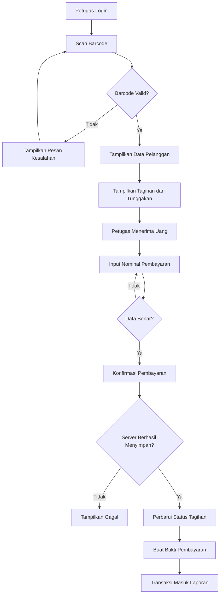

# NetBill Collector
## Aplikasi Penagihan RT/RW Net Berbasis Barcode

**Versi:** 1.0  
**Bahasa:** Indonesia  
**Platform:** Web responsif / PWA  
**Target pengguna:** Admin RT/RW Net dan petugas penagihan  
**Tujuan:** Mempermudah penagihan iuran internet secara langsung ke rumah pelanggan.

---

## 1. Gambaran Umum

NetBill Collector adalah aplikasi penagihan RT/RW Net yang memungkinkan petugas melakukan penagihan dari rumah ke rumah menggunakan barcode atau QR Code ID pelanggan.

Setiap pelanggan mempunyai ID unik yang dapat dicetak sebagai kartu pelanggan. Ketika petugas datang, barcode dipindai menggunakan kamera ponsel. Aplikasi menampilkan identitas pelanggan, paket internet, tagihan berjalan, dan tunggakan.

Setelah petugas menerima uang dari pelanggan, petugas memasukkan nominal yang diterima dan mengonfirmasi pembayaran. Sistem kemudian menyimpan transaksi, memperbarui status tagihan, dan membuat bukti pembayaran.

**Prinsip utama:**
- Scan barcode hanya untuk mengenali pelanggan.
- Pembayaran tidak otomatis tercatat hanya karena barcode dipindai.
- Pembayaran dianggap berhasil setelah tersimpan dan dikonfirmasi oleh server.
- Setiap transaksi memiliki nomor unik dan riwayat audit.
- Transaksi yang sudah berhasil tidak boleh dihapus tanpa jejak.

---

## 2. Tujuan Aplikasi

1. Mempercepat proses penagihan bulanan.
2. Mengurangi kesalahan pencatatan pembayaran.
3. Mempermudah pencarian identitas pelanggan.
4. Mengetahui pelanggan yang sudah membayar dan masih menunggak.
5. Mencatat penerimaan uang oleh setiap petugas.
6. Menyediakan bukti pembayaran.
7. Mempermudah rekonsiliasi uang tunai petugas.
8. Menyediakan laporan keuangan penagihan bagi pemilik usaha.

---

## 3. Hak Akses Pengguna

### 3.1 Admin

Admin dapat:
- Melihat dashboard.
- Mengelola pelanggan.
- Mengelola paket dan tarif internet.
- Membuat tagihan bulanan.
- Mengelola akun petugas.
- Melihat seluruh transaksi.
- Melihat tunggakan pelanggan.
- Melihat laporan pembayaran.
- Memeriksa setoran petugas.
- Mengoreksi atau membatalkan transaksi dengan alasan yang tercatat.
- Mengunduh dan mencetak barcode pelanggan.

### 3.2 Petugas Penagih

Petugas dapat:
- Login menggunakan akun pribadi.
- Melihat pelanggan yang ditugaskan.
- Memindai barcode pelanggan.
- Melihat tagihan dan tunggakan.
- Mencatat uang yang diterima.
- Mengonfirmasi pembayaran.
- Melihat bukti pembayaran.
- Melihat riwayat transaksi miliknya.
- Mencatat hasil kunjungan penagihan.
- Melihat total uang tunai yang harus disetorkan.

Petugas tidak boleh menghapus transaksi, mengubah tarif dasar, atau mengakses laporan keuangan seluruh petugas tanpa izin.

### 3.3 Pelanggan

Pelanggan tidak wajib mempunyai akun aplikasi.

Pelanggan memiliki:
- ID pelanggan.
- Kartu barcode/QR Code.
- Informasi tagihan yang dapat diperlihatkan petugas.
- Bukti pembayaran setelah transaksi berhasil.

---

## 4. Alur Kerja Sistem

1. Admin mendaftarkan pelanggan.
2. Sistem menghasilkan ID pelanggan dan barcode unik.
3. Admin membuat tagihan bulanan.
4. Petugas login menggunakan HP.
5. Petugas membuka menu **Scan Pelanggan**.
6. Petugas memindai barcode.
7. Sistem menampilkan identitas dan tagihan pelanggan.
8. Petugas menyampaikan jumlah tagihan.
9. Pelanggan menyerahkan uang kepada petugas.
10. Petugas memasukkan nominal uang yang diterima.
11. Petugas memilih tagihan yang dibayar.
12. Petugas memeriksa data lalu menekan **Konfirmasi Pembayaran**.
13. Server memvalidasi dan menyimpan transaksi.
14. Sistem memperbarui status tagihan.
15. Sistem menampilkan bukti pembayaran.
16. Admin dapat memantau transaksi melalui dashboard.

### Diagram alur



---

## 5. Modul dan Fitur

### 5.1 Dashboard

Dashboard menampilkan:
- Total pelanggan.
- Pelanggan aktif.
- Tagihan bulan berjalan.
- Total nilai tagihan.
- Total pembayaran hari ini.
- Total pembayaran bulan berjalan.
- Total tunggakan.
- Jumlah pelanggan belum membayar.
- Jumlah kunjungan petugas.
- Total penerimaan tunai yang belum disetorkan.

Semua nilai harus dihitung berdasarkan data database, bukan angka contoh statis.

### 5.2 Manajemen Pelanggan

Data pelanggan:
- ID database.
- Kode pelanggan unik.
- Token barcode unik.
- Nama pelanggan.
- Nomor WhatsApp.
- Alamat lengkap.
- Paket internet.
- Tarif bulanan.
- Tanggal mulai berlangganan.
- Tanggal jatuh tempo.
- Status pelanggan.
- Catatan tambahan.

Status pelanggan:
- Aktif.
- Nonaktif.
- Ditangguhkan.

Fitur:
- Tambah pelanggan.
- Edit data pelanggan.
- Detail pelanggan.
- Cari pelanggan.
- Filter status.
- Cetak kartu pelanggan.
- Unduh barcode/QR Code.
- Lihat riwayat tagihan.
- Lihat riwayat pembayaran.

ID pelanggan yang sudah digunakan tidak boleh diberikan kepada pelanggan lain.

### 5.3 Barcode Pelanggan

Setiap pelanggan mempunyai QR Code unik.

Contoh kode pelanggan:

`RTW-0001`

QR Code sebaiknya berisi token unik yang dapat diverifikasi server, bukan data pribadi lengkap.

Fitur:
- Generate QR Code otomatis.
- Scan melalui kamera HP.
- Pencarian menggunakan kode manual.
- Cetak kartu pelanggan.
- Cetak ulang QR Code.
- Menolak kode yang tidak terdaftar.
- Menampilkan peringatan jika pelanggan nonaktif.

Jika kamera tidak dapat digunakan, petugas tetap bisa memasukkan ID pelanggan secara manual.

### 5.4 Manajemen Paket Internet

Data paket:
- Nama paket.
- Kecepatan internet.
- Harga bulanan.
- Deskripsi.
- Status aktif.

Contoh data pengujian:

| Paket         | Kecepatan | Tarif Contoh |
| ------------- | --------- | -----------: |
| Paket Hemat   | 5 Mbps    |    Rp100.000 |
| Paket Reguler | 10 Mbps   |    Rp150.000 |
| Paket Premium | 20 Mbps   |    Rp200.000 |

Harga di atas hanya data contoh dan harus dapat diubah oleh admin.

Perubahan tarif tidak boleh mengubah nominal tagihan lama secara otomatis.

### 5.5 Manajemen Tagihan

Tagihan dibuat untuk setiap periode berlangganan.

Data tagihan:
- Nomor tagihan.
- Pelanggan.
- Periode tagihan.
- Tanggal penerbitan.
- Tanggal jatuh tempo.
- Nominal tagihan.
- Total pembayaran teralokasi.
- Sisa tagihan.
- Status tagihan.

Status:
- Belum Dibayar.
- Dibayar Sebagian.
- Lunas.
- Dibatalkan.

Fitur:
- Membuat tagihan bulanan.
- Membuat tagihan untuk pelanggan tertentu.
- Melihat tagihan per pelanggan.
- Melihat tagihan jatuh tempo.
- Melihat daftar tunggakan.
- Mencegah tagihan ganda pada periode yang sama.
- Mengalokasikan pembayaran ke tagihan tertentu.

Tagihan lama harus menyimpan nominal sesuai harga ketika tagihan diterbitkan.

### 5.6 Pembayaran di Rumah Pelanggan

Ini adalah fitur inti aplikasi.

Setelah barcode dipindai, tampilkan:

- Kode pelanggan.
- Nama pelanggan.
- Alamat.
- Paket internet.
- Status pelanggan.
- Tagihan bulan berjalan.
- Tunggakan periode sebelumnya.
- Total tagihan.
- Riwayat pembayaran.

Petugas kemudian:
1. Memilih tagihan yang akan dibayar.
2. Memasukkan nominal uang yang benar-benar diterima.
3. Memilih metode pembayaran.
4. Memasukkan catatan jika diperlukan.
5. Memeriksa ringkasan transaksi.
6. Menekan tombol **Konfirmasi Pembayaran**.

Setelah server mengonfirmasi transaksi berhasil, tampilkan notifikasi:

**Pembayaran berhasil dicatat.**

Jika server gagal menyimpan transaksi, aplikasi harus menampilkan pesan kegagalan dan tidak boleh membuat bukti berstatus lunas.

Metode pembayaran tahap awal:
- Tunai.

Metode lain seperti transfer atau QRIS dapat ditambahkan setelah integrasi dan verifikasi benar-benar tersedia.

### 5.7 Pembayaran Sebagian dan Beberapa Periode

Sistem perlu mendukung pembayaran sebagian apabila kebijakan pengelola mengizinkan.

Contoh:
- Tagihan: Rp150.000.
- Uang diterima: Rp100.000.
- Sisa tagihan: Rp50.000.
- Status: Dibayar Sebagian.

Jika pelanggan membayar beberapa bulan sekaligus, petugas dapat memilih beberapa tagihan. Sistem mengalokasikan uang ke tagihan yang dipilih dan memperbarui status setiap tagihan.

Sistem tidak boleh mengalokasikan pembayaran melebihi sisa tagihan tanpa aturan kelebihan bayar yang ditetapkan admin.

### 5.8 Bukti Pembayaran

Setelah transaksi berhasil, buat bukti pembayaran yang dapat ditampilkan dan dicetak.

Bukti pembayaran berisi:
- Nama usaha RT/RW Net.
- Alamat atau kontak usaha.
- Nomor transaksi.
- Tanggal dan waktu pembayaran.
- ID pelanggan.
- Nama pelanggan.
- Periode yang dibayar.
- Nominal pembayaran.
- Metode pembayaran.
- Sisa tagihan.
- Nama petugas.
- Status pembayaran.

Contoh:

```text
================================
       BUKTI PEMBAYARAN
       RT/RW NET ANDA
================================
No. Transaksi : PAY-202610-0001
ID Pelanggan  : RTW-0001
Nama          : Budi Santoso
Periode       : Oktober 2026
Pembayaran    : Rp150.000
Metode        : Tunai
Petugas       : Petugas 01
Status        : BERHASIL
================================
Terima kasih atas pembayaran Anda.
Simpan bukti ini sebagai arsip.
================================
```

Contoh di atas hanya ilustrasi. Nomor transaksi dan data harus dihasilkan dari transaksi sebenarnya.

Bukti pembayaran dapat:
- Ditampilkan di HP.
- Dicetak.
- Diunduh sebagai PDF.
- Dibagikan melalui WhatsApp jika fitur tersebut sudah diimplementasikan.

### 5.9 Riwayat Pembayaran

Fitur:
- Cari nomor transaksi.
- Cari nama atau ID pelanggan.
- Filter tanggal.
- Filter petugas.
- Filter metode pembayaran.
- Filter status.
- Lihat detail transaksi.
- Cetak ulang bukti pembayaran.

Transaksi yang dibatalkan harus tetap terlihat dalam riwayat dengan status dan alasan yang jelas.

### 5.10 Kunjungan Penagihan

Petugas dapat mencatat hasil kunjungan:
- Berhasil menerima pembayaran.
- Pelanggan tidak ada di rumah.
- Pelanggan meminta kunjungan ulang.
- Pelanggan belum dapat membayar.
- Alamat tidak ditemukan.
- Kendala lain.

Kunjungan yang gagal tidak boleh membuat catatan pembayaran.

### 5.11 Setoran Petugas

Untuk pembayaran tunai, sistem menghitung jumlah uang yang harus disetorkan petugas kepada admin.

Contoh:
- Transaksi tunai tercatat: Rp750.000.
- Uang yang diserahkan: Rp700.000.
- Selisih: Rp50.000.

Sistem menampilkan selisih tersebut untuk diperiksa dan diberi keterangan.

Fitur:
- Rekap penerimaan per petugas.
- Catat setoran.
- Konfirmasi penerimaan oleh admin.
- Catat selisih.
- Riwayat setoran.

Setoran petugas tidak boleh mengubah status pembayaran pelanggan.

### 5.12 Laporan

Laporan meliputi:
- Pembayaran harian.
- Pembayaran mingguan.
- Pembayaran bulanan.
- Tagihan belum lunas.
- Tunggakan per pelanggan.
- Transaksi per petugas.
- Rekap penerimaan tunai.
- Setoran dan selisih kas.
- Pelanggan aktif dan nonaktif.

Sediakan filter periode serta ekspor CSV/Excel jika sudah diimplementasikan.

---

## 6. Daftar Halaman

1. Login.
2. Dashboard.
3. Data pelanggan.
4. Tambah/edit pelanggan.
5. Detail pelanggan.
6. Cetak kartu barcode.
7. Data paket internet.
8. Daftar tagihan.
9. Buat tagihan.
10. Scan pelanggan.
11. Detail tagihan pelanggan.
12. Konfirmasi pembayaran.
13. Bukti pembayaran.
14. Riwayat transaksi.
15. Daftar kunjungan.
16. Setoran petugas.
17. Laporan.
18. Manajemen pengguna.
19. Pengaturan usaha.
20. Audit log.

Antarmuka harus responsif, nyaman digunakan melalui layar ponsel, memiliki tombol yang mudah disentuh, dan menampilkan pesan kesalahan yang jelas.

---

## 7. Rancangan Database

Gunakan MySQL atau MariaDB.

### Tabel `users`

- `id`
- `name`
- `username`
- `password`
- `role`
- `is_active`
- `created_at`
- `updated_at`

Role:
- `admin`
- `collector`

### Tabel `packages`

- `id`
- `name`
- `speed`
- `monthly_price`
- `description`
- `is_active`
- `created_at`
- `updated_at`

### Tabel `customers`

- `id`
- `customer_code`
- `barcode_token`
- `name`
- `phone`
- `address`
- `package_id`
- `monthly_fee`
- `started_at`
- `status`
- `notes`
- `created_at`
- `updated_at`

`customer_code` dan `barcode_token` harus unik.

### Tabel `invoices`

- `id`
- `invoice_number`
- `customer_id`
- `billing_period`
- `issued_at`
- `due_date`
- `amount`
- `status`
- `created_at`
- `updated_at`

Periode menggunakan format konsisten, misalnya `2026-10`.

Cegah tagihan ganda untuk pelanggan dan periode yang sama, kecuali melalui prosedur koreksi resmi.

### Tabel `payments`

- `id`
- `transaction_number`
- `idempotency_key`
- `customer_id`
- `collector_id`
- `paid_at`
- `amount_received`
- `payment_method`
- `status`
- `notes`
- `created_at`
- `updated_at`

Nomor transaksi dan kunci idempotensi harus unik.

### Tabel `payment_allocations`

- `id`
- `payment_id`
- `invoice_id`
- `amount_allocated`
- `created_at`
- `updated_at`

Tabel ini menghubungkan pembayaran dengan tagihan. Satu transaksi dapat dialokasikan ke beberapa tagihan jika diizinkan.

### Tabel `collection_visits`

- `id`
- `customer_id`
- `collector_id`
- `visited_at`
- `result`
- `notes`
- `created_at`
- `updated_at`

### Tabel `cash_settlements`

- `id`
- `collector_id`
- `settlement_date`
- `expected_amount`
- `received_amount`
- `difference_amount`
- `confirmed_by`
- `confirmed_at`
- `notes`
- `created_at`
- `updated_at`

### Tabel `audit_logs`

- `id`
- `user_id`
- `action`
- `entity_type`
- `entity_id`
- `old_values`
- `new_values`
- `reason`
- `created_at`

Gunakan foreign key, indeks, validasi nilai nominal, dan transaksi database untuk menjaga konsistensi.

---

## 8. Aturan Bisnis Penting

1. Semua pembayaran harus berasal dari pengguna yang sudah login.
2. Petugas hanya dapat mengakses fitur sesuai hak aksesnya.
3. Data tagihan dan nominal pembayaran harus divalidasi di server.
4. Scan barcode tidak mengubah status tagihan.
5. Pembayaran baru berhasil setelah database mengonfirmasi penyimpanan.
6. Nomor transaksi harus unik.
7. Permintaan berulang akibat koneksi lambat tidak boleh menghasilkan pembayaran ganda.
8. Pembayaran penuh membuat tagihan berstatus lunas jika sisa tagihan menjadi nol.
9. Pembayaran sebagian membuat tagihan berstatus dibayar sebagian.
10. Koreksi dan pembatalan harus memiliki alasan dan jejak audit.
11. Transaksi keuangan tidak boleh dihapus permanen tanpa mekanisme audit.
12. Sistem harus menggunakan transaksi database ketika menyimpan pembayaran dan alokasinya.
13. Simpan waktu transaksi secara konsisten dan tampilkan menggunakan zona waktu WIB.
14. Kegagalan jaringan harus ditangani dengan pesan yang jelas.
15. Jika fitur offline ditambahkan, transaksi yang belum tersinkronisasi tidak boleh dianggap lunas secara final.

---

## 9. Keamanan

- Gunakan HTTPS pada server publik.
- Simpan password dengan hashing yang aman.
- Gunakan middleware autentikasi dan otorisasi.
- Validasi data pada server.
- Gunakan CSRF protection untuk formulir web.
- Jangan memasukkan data pribadi ke dalam QR Code.
- Gunakan token barcode yang sulit ditebak.
- Batasi data pelanggan yang dapat diakses petugas.
- Catat aktivitas penting pada audit log.
- Lakukan backup database secara rutin.
- Uji prosedur pemulihan backup.
- Jangan menampilkan bukti lunas jika transaksi gagal disimpan.
- Sediakan prosedur penonaktifan akun petugas yang tidak lagi bertugas.

---

## 10. Teknologi yang Direkomendasikan

- Backend: Laravel.
- Database: MySQL/MariaDB.
- Antarmuka: Blade dan Bootstrap atau Tailwind CSS.
- Pemindaian QR: pustaka JavaScript pemindai QR yang kompatibel dengan browser ponsel.
- Cetak bukti: halaman cetak responsif dan PDF.
- Platform: web responsif, dapat dikembangkan menjadi PWA.
- Hosting: server dengan HTTPS dan backup database.

Tahap awal disarankan menggunakan QR Code agar mudah dipindai melalui kamera ponsel. Sediakan input kode pelanggan manual sebagai alternatif.

---

## 11. Tahapan Pengembangan

### Tahap 1 — MVP

- Login admin dan petugas.
- Manajemen pelanggan.
- Manajemen paket.
- Generate QR Code pelanggan.
- Pembuatan tagihan.
- Scan QR Code.
- Pencatatan pembayaran tunai.
- Pembayaran penuh dan sebagian.
- Bukti pembayaran.
- Riwayat transaksi.
- Dashboard dan laporan sederhana.

### Tahap 2 — Operasional

- Penugasan pelanggan kepada petugas.
- Kunjungan penagihan.
- Setoran uang tunai.
- Rekonsiliasi kas.
- Ekspor laporan.
- Audit log lengkap.
- Pengingat tagihan.

### Tahap 3 — Pengembangan Lanjutan

- Integrasi WhatsApp.
- Integrasi pembayaran digital.
- PWA.
- Dukungan offline dengan sinkronisasi aman.
- Analisis tren pembayaran dan tunggakan.

---

## 12. Kriteria Penerimaan

Aplikasi dinyatakan memenuhi kebutuhan dasar apabila:

- Admin dapat menambahkan pelanggan.
- Setiap pelanggan memiliki ID dan QR Code unik.
- Petugas dapat login melalui ponsel.
- QR Code dapat dipindai dan menampilkan pelanggan yang tepat.
- Sistem menampilkan tagihan yang sesuai.
- Petugas dapat mencatat nominal yang diterima.
- Pembayaran tersimpan setelah konfirmasi server berhasil.
- Status tagihan diperbarui dengan benar.
- Pembayaran sebagian menyisakan nominal yang tepat.
- Scan ulang tidak membuat pembayaran otomatis.
- Permintaan transaksi berulang tidak menyebabkan duplikasi.
- Bukti pembayaran dapat dibuka kembali.
- Admin dapat melihat laporan transaksi dan tunggakan.
- Koreksi transaksi memerlukan otorisasi dan alasan.
- Aplikasi menangani kegagalan penyimpanan dengan benar.
- Antarmuka nyaman digunakan pada ponsel.

---

## 13. Keputusan yang Perlu Ditentukan

Sebelum aplikasi digunakan secara nyata, tentukan:

1. Nama usaha RT/RW Net.
2. Tarif dan daftar paket internet.
3. Tanggal jatuh tempo.
4. Apakah pembayaran sebagian diperbolehkan.
5. Apakah pelanggan dapat membayar beberapa bulan sekaligus.
6. Apakah terdapat denda keterlambatan.
7. Apakah metode pembayaran hanya tunai.
8. Apakah setiap petugas memiliki wilayah penagihan.
9. Apakah bukti pembayaran harus dicetak atau dikirim melalui WhatsApp.
10. Apakah aplikasi perlu tetap digunakan saat koneksi internet terputus.

---

## 14. Prompt Implementasi OpenCode

Baca seluruh file `README.md` ini dan bangun aplikasi penagihan RT/RW Net berbasis barcode sesuai spesifikasi.

Sebelum menulis kode:
1. Periksa struktur proyek yang tersedia.
2. Identifikasi framework, versi PHP, database, dan dependensi yang sudah terpasang.
3. Pertahankan kode yang sudah benar.
4. Jika proyek masih kosong, buat aplikasi Laravel dengan MySQL/MariaDB dan antarmuka responsif berbahasa Indonesia.

Implementasikan secara bertahap:

1. Database migrations dan relasi.
2. Autentikasi admin dan petugas.
3. Role dan middleware.
4. CRUD pelanggan dan paket internet.
5. ID pelanggan serta QR Code unik.
6. Pembuatan tagihan bulanan.
7. Halaman scan QR melalui kamera ponsel.
8. Halaman detail pelanggan dan tunggakan.
9. Konfirmasi pembayaran tunai.
10. Pembayaran penuh dan sebagian.
11. Transaksi database dan pencegahan pembayaran ganda.
12. Bukti pembayaran.
13. Riwayat transaksi.
14. Dashboard dan laporan.
15. Kunjungan penagihan.
16. Setoran dan rekonsiliasi kas.
17. Audit log.
18. Pengujian otomatis dan dokumentasi deployment.

Jangan hanya membuat mockup atau tombol yang tidak berfungsi. Semua fitur harus terhubung ke backend dan database.

Gunakan validasi server, autentikasi, otorisasi, foreign key, transaksi database, dan perlindungan terhadap duplikasi transaksi.

Jangan membuat transaksi berstatus berhasil sebelum server memastikan data tersimpan. Jangan menghapus transaksi keuangan tanpa jejak audit.

Buat pengujian untuk:
- Scan QR yang valid.
- Scan QR yang tidak valid.
- Pelanggan nonaktif.
- Tagihan belum lunas.
- Pembayaran penuh.
- Pembayaran sebagian.
- Pembayaran beberapa periode.
- Tagihan ganda.
- Pengiriman transaksi berulang.
- Kegagalan penyimpanan.
- Hak akses admin dan petugas.
- Pembatalan dan koreksi transaksi.

Setelah implementasi:
- Jalankan migration dan test yang tersedia.
- Perbaiki error yang ditemukan.
- Jangan mengklaim test berhasil jika belum dijalankan.
- Buat dokumentasi instalasi, konfigurasi `.env`, pembuatan admin awal, menjalankan aplikasi, backup database, dan deployment.
- Dokumentasikan keputusan bisnis yang belum ditentukan.
- Laporkan file yang dibuat, fitur yang sudah berjalan, hasil pengujian, serta pekerjaan yang belum selesai.

Prioritaskan aplikasi yang aman, sederhana, responsif, dan dapat langsung diuji pada HP petugas.
